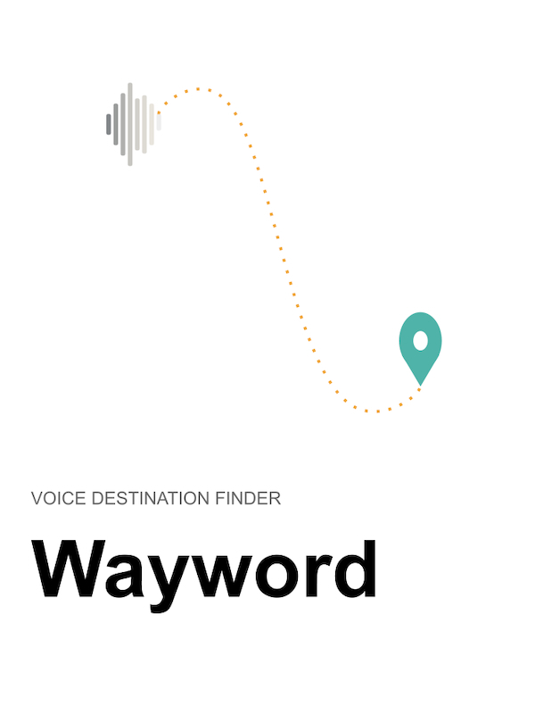

# Wayword

Written by Ian Kim.



Wayword is a voice destination finder for drivers near Andover, Massachusetts. When you say a place name, it listens, matches Massachusetts town names that are easy to mishear, and shows the place. From there you can open the trip in Apple Maps or Google Maps.

The app has three screens: Talk, Result, and History. A place you manually correct by typing is remembered the next time.

## Run

```
python3 server/server.py
```

Open http://127.0.0.1:5173
